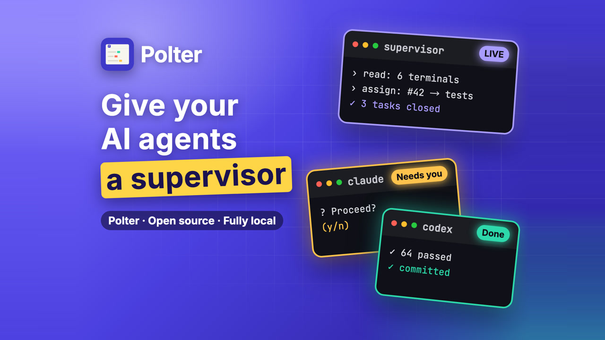

<h1 align="center">
  
  <br>Polter
</h1>

<p align="center">
  <b>The Next-Gen Vibe Studio for Multi-Agent Orchestration.</b><br>
  <b>A terminal-native agentic workspace built on Ghostty: designate one terminal session as the Supervisor to orchestrate an entire squad of coding agents across your screen — reading outputs, dispatching tasks, and auto-answering routine prompts with millisecond-level screen quiescence tracking.</b><br>
  <sub>Step away from single-agent coding and manual tab-hopping. Through the native Model Context Protocol (MCP), your Supervisor reviews peer terminal output, delegates tasks, and routes tiered models; when you step away, it keeps long-running software projects driving toward continuous delivery.</sub>
</p>

<p align="center">
  <a href="#download--installation">Download</a> ·
  <a href="#quick-start-3-minutes">Quick Start</a> ·
  <a href="#why-vibe-studiocore-capabilities">Features</a> ·
  <a href="#structured-ai-screenshots--annotations">AI Screenshots</a> ·
  <a href="#comprehensive-competitive-matrix">Comparisons</a> ·
  <a href="#technical-specifications--safety">Specifications</a> ·
  <a href="#frequently-asked-questions-faq">FAQ</a> ·
  <a href="README_CN.md">中文版</a>
</p>

<p align="center">
  <a href="https://lugia123.github.io/polter/?lang=en"></a><br>
  <sub><a href="https://lugia123.github.io/polter/?lang=en">▶ Watch the 80-second demo video</a></sub>
</p>

<p align="center">
  
  
</p>

---

## The Problem & The Shift: Beyond Solo Vibe Coding to an Agent Squad

Vibe coding with a single AI session (like typing in one IDE chatbox or running a solitary terminal instance of Claude Code / Codex) is magical for generating 50-line prototypes. But in real-world production engineering, that paradigm quickly falls apart:
* **Terminal Chaos:** Frontend in one tab, backend in another, test suites in a third. You spend your day acting as a human switchboard, manually copying diffs and context between windows.
* **Overnight Hang-Ups:** You assign a massive refactoring task before going to bed, only to wake up and discover the agent froze at 1:30 AM waiting for a single `(y/n)` permission prompt. Six hours wasted.
* **Cost & Context Choke:** Running only the most expensive frontier model burns hundreds of dollars in API tokens while its ballooning context window inevitably hallucinated or duplicated code.

**The Polter Solution:**  
Polter is built on the lightning-fast, GPU-accelerated **Ghostty** terminal, with an embedded, deeply optimized Model Context Protocol (MCP) server. You can assign any terminal tab as the **Supervisor**.  
The Supervisor is a standard AI session with an architectural bird's-eye view: it co-designs the technical specification with you, manages an externalized Task Board, coordinates an array of specialized Workers (Feature Coder, Code Cleaner, Integration Tester), and autonomously resolves low-risk confirmation prompts to achieve **true unattended, continuous overnight delivery**.

---

## Download & Installation

[**Download the latest release directly (GitHub Releases)**](https://github.com/Lugia123/polter/releases/latest)

| Operating System | Package | Details |
| :--- | :--- | :--- |
| **macOS 13+** | `Polter-*-macos-universal.zip` | Universal binary supporting Apple Silicon (M-series) and Intel natively. |
| **Windows 10+** | `Polter-*-windows-x64.zip` | x64 portable zip. Extract and run immediately; zero registry edits, no extra privileges needed. |
| **Linux** | Build from source | Build from source (annotation screenshot module to be ported). |

#### macOS Quick Setup:
Early builds are currently unsigned and may trigger macOS Gatekeeper. Open your terminal and run the following to clear the quarantine flag:
```sh
unzip Polter-*-macos-universal.zip
xattr -dr com.apple.quarantine Polter.app
mv Polter.app /Applications/
```
> **Important:** Always launch Polter by double-clicking it in **Finder** or your **Dock**, not from an existing sub-shell, to ensure it properly inherits your system `PATH` containing your AI tools.

#### Windows Quick Setup:
Unzip the archive and run `polter-host.exe` directly (keep bundled DLLs and the `share/` directory in the same folder). If Windows SmartScreen appears, click "More info -> Run anyway".

#### Prerequisites
Ensure your AI CLI tools (such as Claude Code, Codex, OpenCode, etc.) are installed and accessible on your system `PATH`. Polter discovers them automatically on startup.

---

## Quick Start (3 Minutes)

1. **Launch a Terminal:** Open Polter, navigate to your repository, and start your primary coding agent (e.g., `claude`).
2. **Assign the Supervisor:** Click the menu item `Agents → Make This Terminal a Supervisor` (or instruct your agent directly: *"Act as the supervisor to orchestrate other worker terminals"*).
3. **Verify MCP Connection:** Ask the agent: *"Call the `me` tool and report what it says."* When it returns your terminal ID and runtime state, your control plane is active! *(If it reports no such tool, see [FAQ](#frequently-asked-questions-faq)).*
4. **Dispatch Work:** Provide high-level architectural requirements to your Supervisor. It will automatically construct a persistent task board, split terminal panes, and launch specialized Worker terminals.
5. **Step Away:** Minimize the window or go to sleep. Inspect ongoing conversations and task statuses anytime via the control room chat tab (or run `polter +chat`), toggling between Chat, Task Panel, and Statistics with `Tab` / `Shift+Tab`.

---

## Why Vibe Studio? Core Capabilities

*   🎯 **Autonomous Supervisor Orchestration:** Reads visible raw text across peer tabs (zero OCR latency), types commands into worker panes, and splits layouts to spawn new workers on demand.
*   📋 **Durable Task Board & Squad Chat:** Integrated Task Board and inter-agent Group Chat. Tasks, execution states, and communication logs persist on disk and survive terminal restarts.
*   ⏱️ **Millisecond Quiescence Detection:** Dual-clock engine monitors screen idle intervals and tool-call silence, distinguishing genuine reasoning from hung processes.
*   🛡️ **Smart Proxy Approval (No Stalls):** Resolves routine dependency installations and tool confirmations via `terminal_answer_prompt`, while escalating high-risk destructive actions to human notifications.
*   📊 **Full System & Process Resource Overview (New · #2149):**
    *   Embedded `resource_overview` engine monitors Polter's footprint, supervisor/worker processes, and MCP sidecars with minimal overhead;
    *   Dedicated control room metrics dashboard: real-time CPU/memory stats, stacked daily/weekly usage graphs, swap activity, and remaining disk capacity.
*   📁 **Group Workdirs & File Browser Slices (New · #2145):**
    *   Core engine aggregates real working directories per group, tracking active terminals and associated git worktrees;
    *   Enables indexed file inspection within group workspaces, with built-in `too_wide` guards marking root or home directories to prevent accidental overexposure.
*   🎭 **Intelligent Role & CLI Association (New · #2156):**
    *   Store launch parameters (models, system prompts, toolsets) as reusable Roles;
    *   Bind specific agent CLIs to specific roles with automatic launch menu filtering, preventing model mismatches.
*   ⚡ **Dedicated OpenCode 2.x Plugin (New · #2237):**
    *   Independent `opencode-v2` plugin alongside 1.x, offering strict version enforcement and launcher segregation.
*   🔍 **Instant Task Filtering by ID (New · #2248):**
    *   Control room task board supports instant lookup by task number (e.g., `#2149` or `2149`).
*   📜 **Scroll Protection & Fullscreen Viewport (New · #2233, #2235):**
    *   Reviewing scrollback history is protected from jumping back to the bottom when agents output new text;
    *   Claude Code launched via Polter supports native fullscreen drawing.
*   🛡️ **Resilient MCP IPC Sidecars (New · #2170, #2236, #2287):**
    *   Gracefully handles oversized payloads without IPC crashes, automatically releasing large buffers and enforcing robust upstream error recovery.
*   💾 **One-Click Project Restoration (Projects):**
    *   Saves multi-pane split layouts, working directories, tab titles, and shell histories for instant restoration across reboots.
*   🔒 **100% Local & Privacy-First:**
    *   No accounts, no telemetry, no cloud intermediary. All logs and session histories remain strictly on your local disk.

---

## Structured AI Screenshots & Annotations

Polter features an integrated screenshot engine designed specifically for multimodal AI reasoning: **annotations are saved as structured data alongside the pixel buffer.**  
Every capture creates a paired `.json` file recording bounding box coordinates, text notes, and sequence tags. When pasted into your AI agent, annotations are transmitted as clean textual metadata with the image: **no OCR ambiguity, no hallucinated labels.**

*   **Global Shortcuts:** Mac `⌘⇧0`, Windows `Ctrl+Shift+0`.
*   **Automated Stitching:** Seamlessly scrolls and stitches long web pages or multi-page code blocks.
*   **Irreversible Redaction:** Mosaic blur destroys pixel data directly in memory before writing to disk or clipboard.
*   **Supervisor Silent Capture:** Agents can programmatically capture and inspect specific application windows using `screenshot_capture` and `screenshot_long`.

---

## Comprehensive Competitive Matrix

*(Data verified against official documentation and local baselines, 2026)*

| Dimension | Polter (Vibe Studio) | tmux | Claude Code (Sub-agents) | [Claude Squad](https://github.com/smtg-ai/claude-squad) | [cmux](https://github.com/manaflow-ai/cmux) | [herdr](https://github.com/ogulcancelik/herdr) | [Warp](https://docs.warp.dev) |
| :--- | :--- | :--- | :--- | :--- | :--- | :--- | :--- |
| **Category Definition** | **Ghostty-based Multi-Agent Workspace** | Terminal Multiplexer | Intra-session Task Forking | TUI over tmux and git worktrees | Enhanced Terminal (Ghostty fork) | Rust-based CLI Agent Multiplexer | Proprietary AI Terminal |
| **Orchestration Model** | **Autonomous AI Supervisor orchestrates squad** | Manual human switching | Synchronous parent-child blocking | Manual human monitoring | Passive notification sounds | Status indicator monitoring | Single-agent chat sidebar |
| **Idle & Quiescence Sensing** | **Dual-clock: Hardware screen quiescence + Hooks** | Terminal bell only | None (session timeouts only) | None | Agent explicit exit signals | Status tags (idle/blocked) | None |
| **Unattended Proxy Approval** | **Supervisor policy-driven approval (`answer_prompt`)** | None (manual input required) | None (skip-permissions is global/unsafe) | Manual prompt confirmation | None | None | None |
| **Inter-Agent Bus** | **Star Topology: IPC Group Chat + Task Board** | None | Ephemeral parent memory | Branch-based git tracking | None | None | None |
| **Resource Telemetry** | **Full Panorama: Agent procs, memory, swap, disk** | External CLI only (`top`) | None | None | None | Basic process status | Client-only telemetry |
| **Rendering Engine** | **Ghostty Native (Zig, Metal, DirectX, GPU)** | VT terminal | Node.js host | Shell / tmux wrapper | Ghostty (early fork) | Terminal virtual layer | Proprietary engine |
| **Data & Privacy Guarantee** | **100% Local ($XDG_STATE_HOME)** | 100% Local | Anthropic API terms | Local | Local | Local | Cloud account required |

---

## Technical Specifications & Architecture

Polter implements a decoupled multi-agent control plane on top of Ghostty's high-performance terminal core:

```
┌────────────────────────────────────────────────────────────────────────┐
│                        Polter Core Architecture                        │
├────────────────────────────────────────────────────────────────────────┤
│  [Human Layer]    Contract Architecture / Task Auditing / UX Feedback  │
│          ▲                                                             │
│          │ (Native UI / TUI / Menu / Global Shortcuts)                 │
├──────────┼─────────────────────────────────────────────────────────────┤
│  [Supervisor]     Supervisor Agent (Claude Code / Codex / agy)         │
│          ▲                                                             │
│          │ (MCP Protocol: become_supervisor / task_* / terminal_*)    │
├──────────┼─────────────────────────────────────────────────────────────┤
│  [Bus & State]    IPC Pipeline + Local State ($XDG_STATE_HOME/polter)  │
│                   - chat.jsonl (Rotating chat stream, 8MB cap)         │
│                   - tasks/ (Persistent task state machines)            │
│                   - resource_overview (Zero-alloc continuous sampler)  │
├──────────┼─────────────────────────────────────────────────────────────┤
│  [Workers Array]  Worker 1 (Coder)  │ Worker 2 (Cleaner) │ Worker 3... │
│                   Independent processes, tiered model routing          │
├────────────────────────────────────────────────────────────────────────┤
│  [Engine Base]    Ghostty Terminal Core (Zig, GPU Acceleration, PTY)   │
└────────────────────────────────────────────────────────────────────────┘
```

#### 1. MCP Server Tool Registry
*   `become_supervisor`: Upgrades the calling terminal to supervisor standing, granting cross-pane read/write and orchestration tools.
*   `terminal_list` / `terminal_read` / `terminal_send`: Non-intrusive inspection of peer pane buffers and synthetic keyboard typing.
*   `terminal_answer_prompt`: Automated proxy authorization for hung permission prompts.
*   `group_create` / `group_post` / `group_read` / `group_list`: Inter-agent communication bus and persistent auditing streams.
*   `task_create` / `task_assign` / `task_progress` / `task_close` / `task_history`: Structured state-machine task tracking.
*   `resource_overview`: Real-time system monitoring (process trees, allocated memory, swap consumption, disk headroom).

#### 2. Local Storage & Directory Layout
Polter adheres to the XDG Base Directory specification. All state files reside in `$XDG_STATE_HOME/polter/` (`~/.local/state/polter/` on macOS):
*   `chat/`: Inter-agent conversation streams; `chat.jsonl` rotates automatically when exceeding 8MB (`chat.jsonl.1`).
*   `tasks/`: Structured JSON state files tracking active and completed task numbers per group.
*   `projects/`: Saved multi-pane split layouts, working directories, and environment parameters.
*   `launchers.json` & `personas.json`: Role definitions, model assignments, and CLI launch presets.

---

## Security Guardrails (What Polter Refuses to Do)

1.  **Zero Cloud Uploads:** No commercial telemetry, no external database relays, no tracking. Operates entirely offline.
2.  **Unwavering Human Override:**
    *   Set `poltergeist-may-authorise = false` to disable automated proxy approvals globally.
    *   Apply **Shield** to sensitive terminals: shielded panes are completely isolated and immune to programmatic agent interactions.
3.  **Zero Raw Data Retention for Redacted Assets:** Redacted screenshot segments are destroyed in volatile memory before reaching the disk or OS clipboard.

---

## Frequently Asked Questions (FAQ)

**Q: How does Polter differ from AI editors like Cursor or Windsurf?**  
A: Cursor and Windsurf are single-user code editors optimized for focused, single-repository code generation. When projects scale to full-stack execution—requiring simultaneous frontend builds, backend refactoring, database migrations, and performance stress-testing—a single editor chokes. Polter is a **multi-agent Vibe Studio** that orchestrates an entire fleet of autonomous CLI agents in parallel.

**Q: How does the Supervisor prevent overnight task stalls?**  
A: Most unattended agent tasks hang because the CLI hits a minor confirmation prompt (e.g., `npm install`, `read directory?`). Polter's supervisor detects this condition within milliseconds and safely approves low-risk operations via `terminal_answer_prompt`, while escalating high-risk decisions directly to system-level human notifications.

**Q: Which AI CLI tools are supported?**  
A: Polter includes native provisioning and hooks for Claude Code, OpenCode (v1 and v2), Codex, and Antigravity (`agy` on macOS). Any standard terminal-based CLI tool can be executed within worker panes.

**Q: Is local resource consumption heavy?**  
A: Exceptionally light. Built directly on Ghostty's high-efficiency Zig core with GPU-accelerated rendering, Polter's internal telemetry (`resource_overview`) uses static buffer pre-allocations, consuming less than 1% CPU during active full-screen monitoring.

---

## Contact & Upstream Acknowledgements

*   **Issue Tracker & Feedback:** [GitHub Issues](https://github.com/Lugia123/polter/issues)
*   **Inquiries:** [xugf@bestfunc.com](mailto:xugf@bestfunc.com)
*   **Built on Ghostty:** Polter relies on the foundational work of [Ghostty](https://github.com/ghostty-org/ghostty). We track upstream updates continuously under the MIT License.

---
*Special thanks to the [LINUX DO](https://linux.do) community for invaluable early feedback.*
