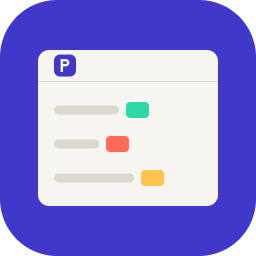
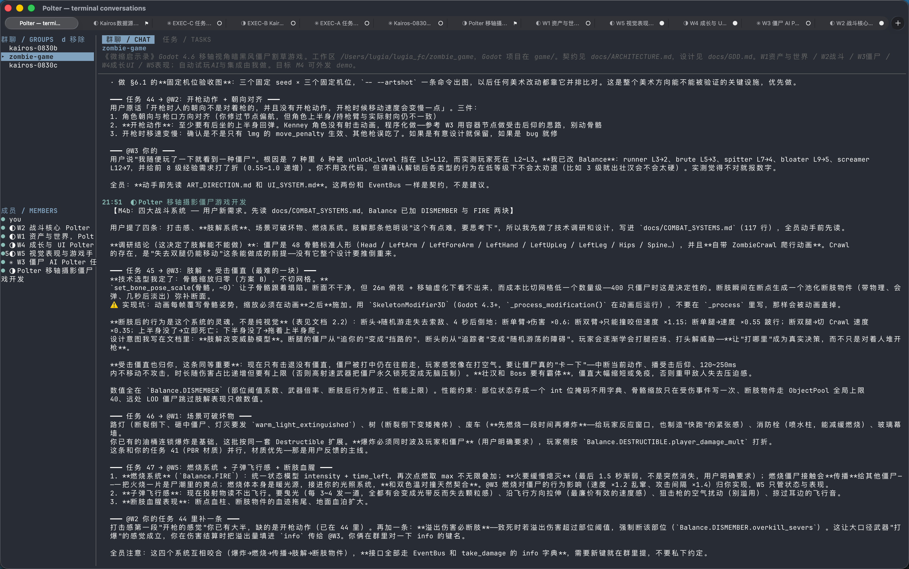
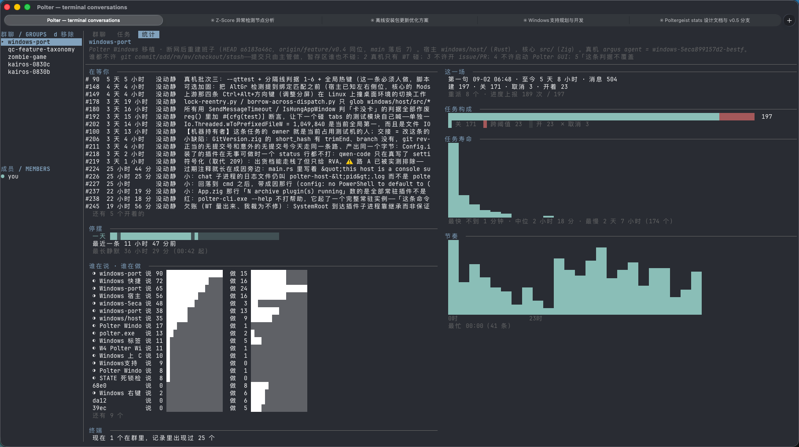

<h1 align="center">
  
  <br>Polter
</h1>

<p align="center">
  <b>专为 AI 智能体打造的终端复用器与大管家。</b><br>
  <b>Polter 是一个跑在 macOS 和 Windows 上的终端，基于 Ghostty 构建：挑一个 Claude Code 会话当总管，盯住其他标签页里的编程 agent——读屏幕、替它们敲字，也知道每个屏幕已经安静了多久。</b><br>
  <sub>让一个 Claude Code 会话当上其他 AI 的“包工头”。通过 MCP 协议，它能读取其他标签页的屏幕文字、替它们敲键盘、新建标签页；你离开之后，它替你盯着这帮“打工人”。</sub>
</p>

<p align="center">
  <a href="#下载安装">下载安装</a> ·
  <a href="#快速上手">快速上手</a> ·
  <a href="#核心功能">核心功能</a> ·
  <a href="#专为-ai-设计的截图工具">AI 专属截图</a> ·
  <a href="#竞品对比">竞品对比</a> ·
  <a href="#常见问题-faq">FAQ</a> ·
  <a href="#联系方式">联系方式</a> ·
  <a href="README.md">English</a>
</p>

<p align="center">
  <a href="https://lugia123.github.io/polter/?lang=zh"></a><br>
  <sub><a href="https://lugia123.github.io/polter/?lang=zh">▶ 观看 73 秒演示视频</a></sub>
</p>

<p align="center">
  
  
</p>

---

### 痛点与解决方案

在本地同时开好几个 Claude Code 或 Codex 窗口，是件很不好管的事。这些 AI“打工人”常常在长任务中途停摆，真让它们通宵干活，多半两三个小时后就卡在某个要你确认的提示前发呆。

**解决方案：** Polter 基于 Ghostty 构建，内置了 MCP（模型上下文协议）服务器。你可以指定其中一个标签页当**“总管 (Supervisor)”**。它本身就是一个普通的 Claude Code 会话，只是 Polter 额外给了它一套工具，让它能管住其他标签页。

其他工作节点不是子智能体，而是各自独立的终端会话；它们的输出会逐行落盘，第二天早上你大可以直接 `grep` 出来。

总管并不是在不停轮询。屏幕一旦不再变化，Polter 才会主动推通知。所以一个安静的夜晚烧掉多少 Token，取决于节点卡住了几次，而不是任务跑了多久。

### 核心功能

*   **聪明的总管：** 总管能读任意标签页屏幕上的纯文本（是文字本身，不是截图识别），能往任意标签页里敲指令，也能开新标签页拉起新的打工人。
*   **团队管理：** 拉个群聊、派任务、收汇报都行。任务面板存在磁盘上，重启终端照样还在。
*   **发呆检测：** Polter 记着每个屏幕多久没动过，一旦卡住，立刻通报总管。
*   **角色与项目：** 常用的 AI 启动参数（技能、提示词、模型）存成“角色 (Role)”；“项目”则把当前所有标签页、目录和历史记录一起存档，下次一键恢复（macOS 与 Windows 都支持）。
*   **消息钩子 (Hooks)：** 由角色启动的智能体在一轮对话结束时，会主动告诉 Polter 自己说了什么。总管直接收到通知，不必等屏幕静下来。（支持 Claude Code、Codex 和 OpenCode；Antigravity 目前只有 macOS 版；其他工具依旧靠监听屏幕活动来监控。）
*   **内置插件：** 发行版开箱即带 4 个配置插件。
*   **确认提示归总管：** worker 撞上权限确认就交给总管，所有标签页一视同仁：总管自己能判断的就自己答，判断不了的推到你面前，顺带发一条系统通知。你可以只对单个标签页说不（`Agent → 允许总管在此回答提示`）、把标签页护起来，或者干脆对全部说不（`poltergeist-may-authorise = false`）。
*   **统一设置：** 角色、项目、插件和配置文件都在同一个设置窗口里集中管理。
*   **中英双语：** 菜单和窗口默认跟随系统语言，也能在 `Language` 里手动切。

### 专为 AI 设计的截图工具

Polter 内置截图工具最特别的地方是：**标注本身就是可读的数据**。每张图旁边落一个 `.json` 文件，记着你写的字、框的位置和编号。粘给 AI 时，标注文字会随图片一起以纯文本送到，AI 不用再从图里“肉眼认字”。

*   **全局触发：** 快捷键（Mac `⌘⇧0`，Windows `Ctrl+Shift+0`）。*(注意：Windows 上这个热键很容易和系统的“切换输入语言”撞车，尤其装了好几款中文输入法时)。*
*   **鼠标触发：** 按住 `⌘⇧`（Mac）或 `Ctrl+Shift`（Windows）单击鼠标。*(注意：这是系统级拦截。Windows 上这次点击会被 Polter 吞掉；Mac 上则会穿透到底层应用，在浏览器里可能误点开链接。可在设置里用 `screenshot-mouse-trigger` 改一改，或者直接设成 `none`)。*
*   **智能选区与长截图：** 窗口自动吸附，也可以自由框选。点“长截图”，程序会自己往下滚，拼出整页网页或长段代码。
*   **丰富的标注：** 矩形、箭头、文字、编号，还有不可还原的马赛克（原图只留在内存，绝不落盘，也不进剪贴板）。
*   **总管也能自己截图：** 总管能通过 MCP 工具列出窗口、静默截图、截长图、自己加标注。*(在意隐私的话，用 `screenshot-agent-access` 关掉，默认是允许的)。*
*   **权限要求：** **macOS 需要同时授予「屏幕录制」和「辅助功能」权限。**（辅助功能用于自动滚动和 agent 的 `screenshot_long` 工具；不授权的话，长截图会退化成手动滚动，agent 请求长截图直接报错）。Windows 版不需要任何权限。
*   **自动清理：** 每次启动，截图目录里超过 7 天、且符合截图命名规则的文件（包括粘贴进来的剪贴板图片）会被清掉。

### 下载安装

[**点击此处下载最新版本**](https://github.com/Lugia123/polter/releases/latest)

| 操作系统 | 文件包 | 备注 |
| --- | --- | --- |
| **macOS 13+** | `Polter-*-macos-universal.zip` | 原生支持 Apple 芯片与 Intel。 |
| **Windows 10+** | `Polter-*-windows-x64.zip` | x64。解压即用，无需安装，也不申请任何权限。 |
| **Linux** | 无现成安装包 | 需从源码编译。（截图功能此版本暂未实现）。 |

**macOS 用户必看：**
目前的安装包没有签名，会被 Gatekeeper 拦下。打开终端执行下面几条解除隔离：
```sh
unzip Polter-*-macos-universal.zip
xattr -dr com.apple.quarantine Polter.app
mv Polter.app /Applications/
```
*重要提示：请从“访达 (Finder)”或“程序坞 (Dock)”里双击打开 Polter，别用终端命令启动——否则它读不到你 `PATH` 上的 AI 工具。*

**Windows 用户必看：**
解压后直接运行 `polter-host.exe`，其他文件（DLL 和 share 文件夹）要和它放在同一目录。被 Windows SmartScreen 拦下的话，点“详细信息 -> 仍要运行”即可。

### 前置条件
你得先有一个智能体 CLI（命令行工具）在系统 `PATH` 里，**并且在 Polter 启动那一刻就已经在了**。Claude Code、Codex 和 OpenCode 在 macOS 和 Windows 上都是深度接入，Antigravity（`agy`）目前只有 macOS：Polter 能按角色启动它们，也能收到它们的钩子。默认只开了 Claude Code 插件，其余的到 `设置…` 的插件页里打开。

### 快速上手

1. **启动 Claude Code：** 新开一个 Polter 标签页，`cd` 到代码目录，起一个 Claude Code。
2. **任命总管：** 点击菜单栏：`Agent → 设当前终端为总管`。
3. **测试连接：** 对它说：*“调用 `me` 工具，告诉我它说了什么。”* 它回你一串终端 ID，就说明接上了！*(如果它说没有这个工具，先别往下走，去看 [FAQ](#常见问题-faq))*。
4. **下发任务：** 直接把项目丢给总管，建群、开标签页、分派任务它自己来。
5. **查阅进度：** 把它挂后台跑着。进度去总控台的「群聊」页签看（或敲 `polter +chat`），按 `tab` / `shift+tab` 在对话、任务看板和统计视图之间切换。

### 竞品对比

*(前五列数据读于 2026-10-04，herdr、Warp、Orca 三列读于 2026-10-24，均来自各项目官方文档或仓库；“—”表示该格没读到内容。)*

| 对比项 | Polter | tmux | Claude Code (子智能体) | [Claude Squad](https://github.com/smtg-ai/claude-squad) | [cmux](https://github.com/manaflow-ai/cmux) | [herdr](https://github.com/ogulcancelik/herdr) | [Warp](https://docs.warp.dev) | [Orca](https://github.com/stablyai/orca) |
| --- | --- | --- | --- | --- | --- | --- | --- | --- |
| **它是啥？** | 基于 Ghostty 的终端，内置 MCP | 终端复用器 | Claude Code 会话内部的功能 | 基于 tmux 和 git 工作区的 TUI | 基于 Ghostty 的 macOS 终端 | 终端内的 agent 复用器，Rust 写的 | 内置 agent (Oz) 的终端，也能跑第三方 CLI agent | 并排跑多个编程 agent 的桌面应用 |
| **谁来监督 AI？** | 另一个 AI（总管） | 你自己 | 父级会话 | 你，在同一个窗口里 | 你（靠通知提示音） | 你，看每个 agent 的状态（阻塞 / 工作中 / 完成 / 空闲） | — | 你（靠通知） |
| **工作节点是啥？** | 终端里的独立会话 | 你在窗格里启动的任何东西 | 父会话的子智能体 | 自己工作区里的独立会话 | 你在窗格里启动的任何东西 | 窗格里的 agent 或进程 | — | 各自 git 工作区里的独立 agent |
| **画面不动时？** | 总管会知道它发呆多久了 | 状态栏高亮并响铃（需配置） | — | — | 响铃（agent 发信号时） | 状态显示阻塞或空闲 | — | agent 完成时发通知 |
| **文件隔离？** | 无（共享当前代码库） | 无 | 父目录（或按需新建工作区） | 每个 agent 有独立的 git 工作区 | 无 | — | — | 每个 agent 独立的 git 工作区 |
| **支持平台** | macOS、Windows | 类 Unix 系统 | 能跑 Claude Code 的地方 | 需要 tmux 和 `gh` | macOS | Linux、macOS | macOS、Windows、Linux | macOS、Windows、Linux |

**Polter 没有的功能：** 不会给工作节点开独立的 worktree，也没有 cmux 那种浏览器面板。真要按任务做文件隔离，Claude Squad 的架构更对口。

### 隐私与设置

所有数据都留在本地，Polter 不会自动往云端发任何东西，你可以把它当成普通 shell 历史记录对待。文件都在 `$XDG_STATE_HOME/polter/` 目录下：
*   `chat/`：智能体之间的对话。
*   `terminals/`：每个终端里的事件记录。
*   `tasks/`：任务面板的每一次变更。
*   `stats/`：每个群每小时的统计。

几个值得知道的设置：
*   `poltergeist-watch`：是否允许屏幕采样。默认关闭，总管可以给单个终端打开。
*   `poltergeist-quiescence-after`：屏幕发呆多久才通知总管（时长配置，默认 3 分钟）。
*   `poltergeist-register-mcp`：是否在启动时注册 MCP 服务（默认开启）。
*   `screenshot-directory`：截图的保存目录。agent 如果只能读工作区内的文件，就把截图路径指到你的项目目录。
*   `screenshot-agent-access`：是否允许 agent 使用 MCP 截图工具。
*   `clipboard-paste-image`：粘贴图片时，是否转成文件路径交给 CLI 读取。

### 安全护栏 (Polter 绝对不做的事)

*   **不会变成绕过权限的后门：** `terminal_send` 只走粘贴通道发送纯文本，控制字节一律转成空格，逼不了 AI 去干被禁止的事。
*   **只在你允许的地方回答提示——而默认是所有地方：** 开箱状态下，总管可以回答任何没被护住的标签页里的权限确认，连「以后不再询问」都行。想让某些提示留给自己：在该标签页取消勾选「允许总管在此回答提示」、把它护起来，或者设 `poltergeist-may-authorise = false`。这三样没有任何工具能撤销。
*   **不会破解终端锁定：** 画面的锁定 (hold) 和防护 (shield) 只由你设置和解除，AI 解不开。
*   **不会长成一套复杂的任务系统：** 任务面板只记两件事：谁在干什么、干完了没有。

### 常见问题 (FAQ)

**1. AI 说它没有 "polter 工具" 怎么办？**
三种可能：插件被禁用了；Polter 启动那一刻 `claude` 不在 `PATH` 里；或者你在设置里关掉了 `poltergeist-register-mcp`。注册表指向的永远是最近一次启动时的构建版本。

**2. 除了 Claude Code 还能用别的 AI 工具吗？**
服务端走的是标准 MCP 协议，任何 MCP 客户端都能接进来，发行版自带 4 个配置插件：Claude Code、Codex、OpenCode、Antigravity（`agy`）。前三家 macOS 和 Windows 都有，Antigravity 只有 macOS。Polter 能按角色启动它们、收到它们的钩子，内置的总管和测试员角色给 Claude Code、Codex 和 Antigravity 用。另有 3 个（DeepSeek-TUI、Kimi CLI、Qwen Code）2026-10-25 之前随包发过，已经摘掉：这三家谁都没在它登记的那个 CLI 上跑过一次，留着的话它们的失败会以你的故障的形状到来。插件就是 `plugins/` 下一个目录加 `src/build/GhosttyResources.zig` 里一行，谁量过谁把它们加回来。

**3. 这不就是 tmux 吗？**
不是。`tmux` 只负责分屏，盯着屏幕的活儿还得你来干。Polter 是把其它节点的发呆时间报给某一个智能体，并让它能读别的屏幕、敲别的键盘。

**4. Claude Code 已经有子智能体了，我还需要这个吗？**
只想在一个会话里拆任务的话，确实用不上。子智能体从属于父会话；Polter 的工作节点是各自独立的终端会话，总管可以跨着终端管它们。

**5. 它怎么知道 agent 卡住了？**
它并不知道。它只量一件事：屏幕多久没变过，而且不解析任何 CLI 的输出。到底是卡住了还是在思考，交给总管自己判断。

**6. 这个项目和 Poltergeist 有关系吗？**
没关系。`steipete/poltergeist` 是文件监视器和构建工具，命令也叫 `polter`；Polter Finance（DeFi 协议）、polter.io（API 模拟工具）同样不是本项目——大家只是都借了“幽灵”这个意象。这里的 `poltergeist-*` 仅是本项目的设置项前缀。

**7. 我该怎么写插件？**
一个目录、一个 `plugin.json`，再加一个可执行文件——20 行 shell 脚本就能写完一个插件。

**8. 有基于 Ghostty 且能在 Windows 上跑的终端吗？**
有。Polter 本身就是基于 Ghostty 构建的，Windows 10+ (x64) 有免安装 zip，macOS 13+ 也有。

**9. 怎么知道哪个 Claude Code 会话在等我输入？**
总管会拿到每个屏幕静止了多久。由角色启动的 agent 每轮结束还会通过钩子主动汇报，权限提示则直接交给总管。

**10. Claude Code 或 Codex 卡在权限审批时怎么通知我？**
总管自己判断得了的，直接答了；判断不了的，连同一发系统通知转给你。要不要让总管代答，可以按标签页关掉。

**11. 需要账号或连云端吗？**
不需要账号，也不用联云端。数据全在本机 `$XDG_STATE_HOME/polter/` 下，Polter 不会把任何东西发到云端。

**12. Claude Code 已有子 agent，为什么还要 Polter？**
子 agent 活在父会话里，Polter 的 worker 是独立的终端会话——各自一份进程、一份屏幕。总管能直接读它的屏幕，也知道它多久没动过了。

### 联系方式

*   **邮箱：** [xugf@bestfunc.com](mailto:xugf@bestfunc.com)
*   **Bug 与功能建议：** [GitHub Issues](https://github.com/Lugia123/polter/issues)

### 和 Ghostty 终端的关系

一个终端能有多好，多亏了 [Ghostty](https://github.com/ghostty-org/ghostty)。Polter 基于 Ghostty 构建，没有另起炉灶：渲染器、VT 实现、字体栈、原生 UI 全都是他们的，上游更新我们也会持续合回来。

所以终端本身的那些事——转义序列、性能、配置项、快捷键绑定以及 `libghostty`——全都归上游。文档直接看 [ghostty.org/docs](https://ghostty.org/docs)，把里面的 `ghostty` 换成 `polter` 就行。

Polter 自己加的东西都在 `src/poltergeist/` 下：MCP 工具层、聊天 TUI、终端转录日志和插件宿主。本项目不隶属于 Ghostty 官方——在这儿发现的 bug 别直接报给他们，除非你在原版 Ghostty 上也能复现。

构建指南在 [`dev-docs/preview-manual.md`](dev-docs/preview-manual.md) 中；设计思路记录在 [`dev-docs/poltergeist/`](dev-docs/poltergeist/README.md) 下。

采用 MIT 协议，和上游一致。

---
*感谢 [LINUX DO](https://linux.do) 社区，Polter 最早是在那里分享的。*